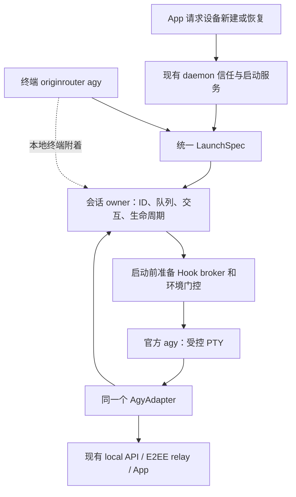

# agy 统一受控原生运行时：设计与实施指南

日期：2026-11-20。状态：**方向已确认，统一原生运行时已按本指南实施。**

终端与 App 新建现在共用 agy-pty；旧 ACP 会话按记录保留。下文第 2 节与早期实验描述是改造前基线，实施后的能力与验收见 [最新矩阵](antigravity-feature-parity.md) 和 [新增证据](fixtures/agy-unified-runtime-live-2026-11-20.json)。通用原生面板、自动中断后续跑、独立 attach/detach 客户端仍不声明支持。

依据：本仓库实际 Claude/Codex/agy 调用链、Google 官方文档、官方 agy **1.5.13 / macOS ARM64** 隔离实验。已有 ACP 验证不能证明原生 TUI 支持同样接口；其他版本、Windows/Linux、实体手机公网链路需按本文验收。

## 1. 结论与不可变约束

推荐：终端与 App 都创建同一类型的 **OriginRouter 会话 owner → 官方 agy PTY → 同一个 AgyAdapter**。区别只在输入输出是否附着本地终端。启动前建立 Hook broker、会话身份和控制策略，随后启动我们拥有的官方进程。无需先寻找一个可以附着任意裸 agy 的 API。



- 保留 Google 官方登录及额度；不读凭据，不创建第三方 Google OAuth 客户端，不注入模型 Provider/Base URL。
- agy 固定原生配置。Claude/Codex 只有显式 native-config 才走原生目录/原生切换；网关模式继续固定原生别名、由网关切实际模型。
- 不能按 App/终端启动来源选择 ACP/PTY 或不同审批政策。相同配置、版本与账号，能力必须一致。
- 不改现有 Claude/Codex 的默认映射来凑一致。复用它们的业务协议和安全边界，分别尊重官方控制接口。
- 不把 ACP 当成现有 TUI 的旁路控制器，也不在恢复失败时静默改用 ACP。保留已实现 ACP 代码和现有 ACP 会话；是否作为显式高级模式提供，另行确认。
- 不把“设计可实施”写成“产品已全部实现”。以下分开说明当前事实、推荐实现和明确不承诺的能力。

## 2. 实际对标基线

| 入口 | 当前实际执行 | 控制来源 |
| --- | --- | --- |
| originrouter claude | 官方 Claude TUI + PTY | 启动前临时 --settings 注入 Hook；PermissionRequest、AskUserQuestion updatedInput.answers、Elicitation 等；转录与部分经确认的菜单操作 |
| App 新建 Claude | claude-sdk | canUseTool、onElicitation、SDK 控制和流式事件 |
| originrouter codex | 官方 Codex TUI + PTY | PTY 输入、中断、rollout JSONL；createAdapter 明确 appServerAvailable:false |
| App 新建 Codex | codex-app-server | 正式 RPC、审批、输入请求、目录和 thread 配置 |
| originrouter agy | 官方 agy TUI + PTY | 启动前全局环境门控 Hook、localhost broker、原生转录 |
| App 新建 agy | agy-acp | 官方 agy acp；当前正是要消除的按入口分流 |

所以 Claude/Codex 现状是“同一 OriginRouter 业务协议、不同底层适配器”，并非已经有一套可直接套到任何原生 CLI 的秘密注入接口。原生 Codex 的结构化审批也没有与 app-server 完全对齐。`docs/agent-control-capability-matrix.md` 中 Claude mode 的旧 display-only 描述需后续随实现复核，不能覆盖现行代码事实。

关键代码：`src/index.js`、`src/daemon/managedAgentSupervisor.js`、`src/local/localAgentSession.js`、`src/adapters/{createAdapter,claudeAdapter,codexAdapter,agyAdapter,agyAcpAdapter}.js`、`src/runtime/{claudeSdkSession,codexAppServerSession,agyNativeSession}.js`。

## 3. 本轮实验直接决定的设计

原始记录仅在本机临时目录，包含实验对话，不原样上传。整理证据见 `docs/fixtures/agy-unified-design-1.5.13.json`。没有打开用户既有的 25b88094 会话。

| 实验 | 实际结果 | 设计决定 |
| --- | --- | --- |
| 原生单选 | PreToolUse 收到 ask_question 的 questions 数组；PTY 下箭头+Enter 选择 BETA2；同 call ID、step 6 的 PostToolUse 成功；转录 A1:BETA2 | 可实现 App 结构化单选；以原生结果确认，不用模型自述或按键回显确认 |
| 原生多选 | is_multi_select:true，空格切换两个选项后 Enter；同 call ID、step 10 完成；转录 GREEN_MARK, BLUE_MARK | 可实现 App 多选；必须跟踪当前勾选集合，不能把多选当连续单选 |
| 审批先后 | timeout:300 的 PreToolUse 故意等待约 10 秒；等待中没有 File access 菜单；返回 force_ask 后菜单出现 | 阻塞 Hook 时本地也必须有 OriginRouter 决策入口；不能只显示 App 卡片 |
| hooks 放进 --settings | 官方立即退出 1，错误 `--settings: unknown setting "hooks"` | 不采用 Claude 式临时 settings Hook 注入 |
| --settings 写回目标 | 临时 settings 文件启动，沙箱只禁止真实 settings.json 及同名前缀临时文件写入；/effort high→low 显示已切换，但报告 Failed to save settings，目标是真实默认路径；两份文件未改 | --settings 不是独立的可写配置档；禁止远程用 /model、/effort 保存默认值 |
| 精确恢复并换模型 | PID 11803 的 medium 会话结束后，PID 14205 使用 --conversation=同一 ID、--model gemini-3.8-flash-low；Hook 和真实回复模型均为 low，成功回忆 BETA2 | 支持逻辑会话保留、原生子进程重建。不是同一 PID 内热切 |
| 原生模型目录 | agy models 返回本账号 6 个 ID/显示名，包含 Flash high/medium/low 变体 | 动态目录来自本机账号；不能直接把所有模型统一套 low..max |
| 参数组合 | 同时传 --model gemini-3.8-flash-low 和 --effort low 曾报告该模型不支持 effort | 优先按官方返回的精确模型变体 ID 选择；参数被接受/进程还活着不等于设置已生效 |
| 启动工作区 Hook 加载 | 第一次进新临时工作区时，首条交互任务先于 workspace Hook 加载；下一轮正常捕获全部事件 | 控制入口必须在进程启动前可用；App 初始消息延后至可控就绪，不直接依赖 -i 抢跑 |
| timeout:0 | 第二次读取的 PreToolUse 实际等待 2002ms 后返回 allow，原生读文件成功 | 材料中“0 会立即杀进程”不适用于本次实测；不据此推断无限等待，仍使用正数期限 |
| 原生图片文件引用 | 同会话 read_file 读取测试 PNG；step 34 结果含 image/png media，实际回复 Left:Red / Right:Blue | 可设计 App 上传→会话文件引用路线，不必一律禁用图片；区别于 ACP 直接图片块 |

配置保护实验使用 macOS sandbox-exec；最初过宽的沙箱曾阻止 brain/history 写入，该次恢复实验作废，随后用正常可写的原生存储重做并通过。配置写回实验另用仅针对 settings 文件的窄规则复测通过。普通实验中官方 agy 保存了临时工作区信任记录，因此不能声称真实 settings 文件逐字节始终未变；用户模型默认仍为 Gemini 3.8 Flash (High)。没有备份覆盖还原默认文件。

既有真实验证继续有效：消息/多行中文、Hook allow/deny/auto_approve、原生显式 deny 优先于 auto_approve、5 秒 Hook 超时、非零退出/无效 JSON 阻断、中断后继续、等待 Hook 时中断与迟到答案拒绝、停止前台命令和精确恢复。见 `agy-native-tui-validation.md` 及既有 fixtures。

`timeout:300` 被接受且实际跨越 10 秒，不证明无限等待、300 秒完整等待或官方最大上限。生产使用有限交互期限，broker 截止时间早于 Hook 超时；绝不依赖 timeout:0 实现无限等待。现有配置 3605 秒也不能只凭数值存在就算实测通过。

## 4. 完整生命周期逐项对标

下表“可实现”是本轮确定的实施路线，不表示已上线。所有能力同时适用于两种启动入口。

| 阶段/功能 | Claude/Codex 对标点 | agy 实现路线与确认来源 | 产品边界 |
| --- | --- | --- | --- |
| 可选安装、更新、版本 | 原生工具发现/安装 | 沿用可选官方安装；不使用不存在的 npm 包；完成后发现 agy 并测版本 | 不替换用户已有可用版本；安装失败可跳过，不阻断 C/C |
| 网络与子进程环境 | wrapper/daemon env | 已有代理变量优先，无变量才查 OS 静态代理；对安装及 agy 启动重新解析并继承大小写变量 | 只改本进程/后代，不写 shell；PAC 不是静态 URL；系统代理≠可联网承诺 |
| 新建、信任、账号 | managed launch + native-config | 共用 LaunchSpec；先检查现有 OriginRouter workspace trust，再处理官方 native trust/login 状态 | 不自动跨过未知权限页；缺少登录保留 needs_login，可本机官方登录后继续 |
| 注入时点 | Claude beforeStart | 先开 broker 和 owner，再原子合并已有 named global Hook；child env 带每次运行 token | 不写用户项目 .agents，不移除其他 Hook；裸 agy 环境门控不连接 broker，仍有微小子进程开销 |
| 会话注册、身份、标题 | 原生 ID / OR ID 绑定 | 先登记 OR conversation/run/session；Hook 首次上报后绑定 native conversation ID、原生日志 | SessionStart 不保证首个输入前触发；恢复校验 ID，禁止同一原生会话双 owner |
| 原生 TUI、本地附着、后台 PTY | PtyExecutor | 同一 adapter、同一状态机；本地只附着输入输出；后台保留虚拟 PTY 与固定初始尺寸 | 是否有窗口不决定模型/审批/问答能力；后台并非 stdio print 模式 |
| 初始消息、普通消息、多行 | SDK send / PTY submit | 启动后排队，确认正常编辑器且无本地草稿/模态才 bracketed paste/submit；原生 USER_INPUT 对账 | 消息有 queued/submitted/applied/failed，不能把 accepted 当模型已收到；不清空本地草稿 |
| 执行中追问/排队 | ACP steering / native queue | 优先 OR 持久队列等可安全提交时机；会话显式允许时采用原生 queuedMessages 语义 | 不承诺 ACP 并发 prompt 等价于 TUI steering；不把 Stop.reason 当用户消息 |
| 文本、思考摘要、工具、diff、历史 | transcript/rollout/SDK events | Hooks 提供控制与 ID；转录提供实际文本、工具结果及账实 token；文件变化/已报告 patch 提供 diff | 只展示官方暴露内容；不伪造连续 token 流、隐藏推理、总账单和余额 |
| OriginRouter 工具审批/策略 | C/C pending interaction | PreToolUse → 共享 InteractionCoordinator → 本地 OR 提示/App 卡片同一 ID；同意 auto_approve，拒绝 deny | auto_approve 仍服从原生 deny；有额外原生提示时继续转 native-panel 子状态，不能报执行成功 |
| 原生额外权限弹窗 | Claude PermissionRequest/Codex RPC | 已知 File access 可经屏幕状态+精确 PTY 操作；串行输入，匹配工具结果 | agy 无独立 PermissionRequest Hook；未知面板不猜按键。force_ask 不作为强制统一策略 |
| 原生单选/多选 | AskUserQuestion / request_user_input | ask_question Hook 结构化采集→放行原生题面→App 答案转经版本验证的 PTY 操作→同 tool/step 结果 ACK | 已实测；多题、Write-in、跳过按面板状态逐步驱动并纳入准入测试，不能 deny+reason 冒充作答 |
| 通用 MCP 表单、URL 授权 | C/C Elicitation / ACP elicitation | 继续官方原生交互；只有识别到相应公开/已验收响应通道才渲染可提交卡片 | 当前六个 CLI Hooks 没有通用表单响应契约；不能把 ACP schema 能力标给 TUI |
| 计划与 artifact | ExitPlanMode / plan events | 已有原生 artifact/plan 内容镜像；确认若由 ask_question 承载就共用问答驱动；其他原生 review 界面单独识别 | 不用拒绝工具来假装批准计划；尚无通用 approve-artifact RPC 可套用 |
| 原生模型/思考/执行模式 | native-config 目录与 setter | agy models 动态目录；启动 flags；运行中 pending→等待完全空闲→退出旧 child→精确 conversation 恢复新 child→核对实际配置 | 显示“重启会话后应用”；有后台工作/未确认交互/草稿则延后，不承诺透明或即时；未确认值不能乐观更新 |
| 网关模式 | 固定原生模型别名 | 完全保留 C/C 原网关选择；agy 没有这一路 | 原生目录不得覆盖网关模型列表，native-config 不接受 Provider |
| slash skills、压缩、usage | 命令目录/SDK command | 区分 prompt skill、native UI、OR 本地命令；已知 prompt skill 正常提交；/compact 用原生命令执行并观察实际完成 | 没有 compaction Hook；不把 /config、/login、/logout 等 UI/账号命令伪装成聊天动作 |
| 文本附件 | C/C content block / ACP resource | 可把限长 UTF-8 文本作为明确的用户附件文本提交，保留附件名和原 messageId；不解释为系统指令 | 明示是文本展开；必须确认 USER_INPUT 内容，超限/拒收保留 App 草稿 |
| 图片/二进制附件 | ACP image/resource | PNG 原生文件引用已实测。App 上传的图片保存到 session 独享临时目录，经用户授权的原生可读路径在用户消息中引用；read_file 的媒体结果确认读取 | 不是直接图片块 API；临时文件需保留至读取/重试结束并清理，大小/MIME/路径受控。不泛化到任意 PDF/二进制，不改剪贴板；端到端上传未验收前不 advertised |
| 用户已有 MCP | C/C native MCP | 由官方加载用户原有 MCP；工具事件按实际名字映射并保留审批 | 不修改原有 MCP 名称/权限/登录 |
| OR device-tools MCP | session-bound MCP gateway | 官方 TUI 支持 global/workspace/plugin mcp_config.json。可选安装命名 OR server，环境门控后只在受控会话暴露设备工具，复用现有 session-bound daemon 审批 | 没有已核实的 TUI 临时 MCP config flag；注册全局入口是持久集成，必须单独显示、可卸载。不能自动写项目配置或宣称已完成 ACP 等价验收 |
| 后台任务、side question | C/C task events、原生 /btw | 同步已暴露的任务/命令状态；fullyIdle:false 保留 busy_background；/btw 仍是原生面板 | 不声称远程后台任务列表/单个 kill 已有稳定 RPC，不把 /btw 当 session/fork |
| 打断与继续 | interrupt/cancel ACK | Ctrl+C/已验收原生按键，立即取消本次 Hook 等待；结合原生日志和状态确认 | Ctrl+C 不保证 Stop；断连不是任务完成，不自动重复发送未确认消息 |
| 停止、退出、清理 | process tree stop | owner 停止 worker/PTY、关闭 broker、失效 token/交互、刷新最后历史与 run 状态 | 区分 turn 完成与 session 结束；不保证任意脱离进程树的外部服务都退出 |
| 重连、本机 attach | daemon register/snapshot | 活 owner 重连只重注册并回放快照；attach 到 owner，重放虚拟终端当前屏幕；resize 与输入带 lease | 不拉第二个 agy/ACP 争用同一 native conversation；attach 是需新增的产品接口，不冒充现有功能 |
| 崩溃、恢复、无人值守 | runtime supervisor | 保存 native ID/epoch/receipt 后显式恢复；监督器可在确认为 idle/已取消后提出有来源的续跑消息 | 进程丢失后的未确认工具不自动重做；未知表单/未确认取消时关闭自动恢复，不宣称有正式 RPC cancel ACK |
| 多智能体/定时任务 | 既有 orchestration | 本轮保持此前商定的延期范围 | 官方 agy 自己的 skill 不等于启用 OR 分布式调度 |

## 5. 控制面的具体设计

### 5.1 会话 owner、终端与状态机

第一阶段保留现有 wrapper 为 owner：无论由终端还是 supervisor 启动，都调用同一个 `runLocalAgentSession('agy', ...)`，后台由现有 PtyExecutor 提供终端，不能因 `stdio:ignore` 改协议。

推荐状态：starting → needs_login / needs_native_trust → idle → running → waiting_approval / waiting_question / waiting_native_panel → idle 或 busy_background；另有 interrupting、reconfiguring、stopping、stopped、failed。App 连接状态独立，不能把 disconnected 等同于 idle。

输入统一串行化：本地按键、App 消息、问题答案、菜单操作都进入一个 InputArbiter。保留 draftRevision、screenRevision、interactionId、ownerEpoch 和本地输入 lease。远程操作前验证题面及 revision；事务期间串行处理本地输入，观察结果后才释放；状态漂移返回 stale/unknown，不重试一串相同按键。不能继续让本地 stdin 直接绕过仲裁写 `executor.write`。

首期不承诺关闭本地终端后 owner 自动继续运行；那涉及独立的进程所有权策略。后续若需要 detach/attach 与终端退出后存活，两种启动入口都迁移到同一个 daemon worker，终端仅做 attach client。不是只迁移 App 路径。

用真正的终端屏幕模型处理 ANSI、清屏、alternate screen、resize；不要继续用拼接 stripANSI 文本的 lastIndexOf 当可靠焦点判断。`altScreenMode:never` 只可作为经用户配置/会话覆盖的兼容选项，不替代屏幕模型，也不必强制改变用户的 TUI 外观。

### 5.2 审批：本地与 App 同一决策

OriginRouter 策略要求审批时：Hook 挂起，但本地 wrapper 渲染一条清楚标注的 OriginRouter 审批提示；App 显示同一工具卡。两端调用相同 PendingInteractionRegistry，先收到的有效答案赢。提示所消费的本地键不转给 agy。无本地 attach 时只是少了一个输入端，审批语义不变。

这个提示属于 OR 的审批层，不能冒充官方 agy 已弹出的菜单。Hook 放行后，原生规则仍可能拒绝或再询问；如有原生提示，进入单独的 native-panel 状态，最终结果来自原生工具结果。App 区分“决定已送达”和“工具执行完成”。默认不用 force_ask 统一所有工具：它改变原生询问策略，且不同路径别名的规则匹配实验不足以证明所有 deny 优先级。

不需要 OR 人工审批的动作直接交回 native allow；未知工具仍按既有策略评估，不因静态名称列表未识别而绕过。

人工交互期限建议先按已验证版本采用 Hook 300 秒、broker 例如 285 秒，另留输出/进程启动裕量；默认以产品现有更短期限为准。300 秒完整等待仍需专门验收。超时/退出/中断/失联统一取消，迟到答案不得作用于新 epoch。不能靠修改 timeout 就承诺可靠人工等待。

### 5.3 问答与真实 ACK

`ask_question` 的 PreToolUse 上报完整题目后立即 allow，使原生面板可出现；它是问答，不应被通用工具审批误拦成“是否允许询问”。如果策略另有要求，先完成 OR 审批再进入问答面板，两个 interaction 不混用。

App 作答事务：确认 conversation/epoch/toolId/step/题面 → 读取当前题号、光标和已选项 → 写入精确按键 → 等待同工具结果。单选、多选、Write-in、多题都遵守同一驱动约束。PostToolUse 说明该工具结束，但不携带本次实测答案；再读相应 step 的转录结果确认所选值。原生本地先作答也用相同结果关闭 App 卡片。

`transcript` 的 tool args 有时为已解析对象，有时某个参数仍为 JSON 字符串；适配器需限长解析并按 schema 校验。结果关联使用 Hook callId+step，不以工具名或 FIFO 猜测；相同 step 从 running 更新为 DONE/ERROR 必须更新事件，不能 seen(step) 后永久跳过。

未获得具体 tool 的结果不判成功。超过响应期限标成 awaiting_confirmation/unknown，禁止盲目重新按 Enter。通用 PreInvocation 或任意新日志不是某份答案的确认。`deny + reason=答案` 的语义是工具拒绝，明确不采用。

### 5.4 模型、思考深度和模式

显示目录来自当前设备当前账号的 `agy models`，缓存以版本/账号可用状态绑定，登录失效后失效；目录不是 OR Provider。Flash 的 high/medium/low 已是模型 ID 变体，不能在每个 ID 上再乱附 --effort。只有官方证实支持的 effort 才列出；没有数据则灰显。

启动选择使用 session flags。运行中改变参数：

1. 记录 requestId、target、当前实际配置，App 显示“等待空闲后重启应用”。
2. 检查无活动交互、无本地草稿、无待发送事务、无后台任务；Stop.fullyIdle 与其他事实一致。不会只靠 Stop。
3. 保存 native ID 和最后持久化 cursor；冻结新输入。
4. 优雅结束旧 child，确认退出并清理其前台子进程，撤销旧 Hook token 和 pending 卡；仍保留 OR owner 与逻辑会话。
5. 用新 `--model`/经支持的 `--effort`/`--mode` 和 **`--conversation=<exactId>`** 启动；生成新 token、epoch，物理 PTY/PID 可以改变。
6. 确认实际 native ID、模型和历史；对努力/模式需要原生 status/已验收的只读 UI 证据，不能从 argv 自报成功。尚无权威证据时保持 pending，必要时灰显 setter。
7. 绑定新 PTY、恢复输入并回放快照；失败保持实际状态和恢复入口。回滚也只可在单 owner 下按旧参数恢复，不能覆盖全局设置或另开并行 ACP。

这是明确的重启操作，草稿/后台任务未完成时不能宣称无损。用户自己在原生 TUI 改默认配置属于官方原有行为；OR 不拦截、还原用户操作。OR 远程设置不执行持久化的 /model、/effort、/config。

### 5.5 生命周期注入与监督器

正式字段是 `injectSteps`，不是 additionalContext。SessionStart/PreInvocation 可注入 `userMessage`、`systemMessage` 等，分别保留角色。Stop 的 continue.reason 是系统消息，不能把 App 用户追问塞进去冒充 USER_INPUT。

普通追问先走安全输入队列；策略上下文才走 systemMessage。需要继续执行时，优先确定性地提交一条带 origin=supervisor 的消息；可对正式 PostInvocation force_continue+userMessage 做专项准入，但不能在未经验证时默认开启。Stop continue 必须有限次、去重、尊重用户停止，不能用于无限自动续跑。

进程代际信息属于本地控制面，可通过现有加密控制通道传递；应用服务器只保留已有安全状态/审计元信息。原始屏幕/转录若新增远程终端功能，须走现有认证与 E2EE，独立 opt-in，不混入普通事件广播或云端持久化。

## 6. 下一步实际改动顺序

| 顺序 | 文件/模块 | 具体操作 | 进入下一步的条件 |
| --- | --- | --- | --- |
| 1 | 新增统一 LaunchSpec helper；index.js、agyNativeSession.js、managedAgentSupervisor.js | runtime 与启动来源分离；持久化 runtime；新/恢复共享 agy-native；App initialMessage 进 owner 队列。若用官方初始 prompt 参数，只能 -i/--prompt-interactive，不能 --prompt | 相同参数两入口得到同一 adapter/runtime；已有 ACP 会话恢复仍为 ACP；不改 C/C 映射 |
| 2 | localAgentSession.js、PtyExecutor、agyAdapter.js | 后台虚拟 PTY 保持解析；新增输入仲裁/屏幕模型；区分 needs_login、trust、ready；所有本地 stdin/App 写入走仲裁 | stdin 非 TTY/无窗口的真实进程可持续交互；不向模态页发首条消息；草稿不丢 |
| 3 | agy/hookSettings.js、hookServer.js、forwarder | 沿用独立命名全局 entry、环境门控和绝对路径；加版本/连接就绪、epoch、有限等待、Hook 回包 schema；保留用户 Hook | 并发安装无损；裸 agy 不受 OR 决策；旧 token 不能解锁新运行 |
| 4 | PendingInteractionRegistry、agyAdapter、终端提示渲染 | OR 审批的本地与 App 双入口；与 native-panel 分阶段；ask_question 专门路由 | 两端先答者有效、迟到回复被拒；native deny 优先；取消/超时无静默允许 |
| 5 | 新增 agy native interaction driver；agy/history.js | 单/多选、多题、Write-in、跳过；callId+step 关联、转录更新而非一次性 seen；并行工具不 FIFO 错配 | 结构化答案与原生结果一致；宽高变化/草稿/本地抢答/迟到 reply 均可复现 |
| 6 | nativeModelControl.js、owner child lifecycle、agyAdapter | 动态原生目录与只读状态；重启恢复 setter；禁止默认文件菜单写入；scope=native | medium→low→原模型同对话；后台任务阻止切换；失败不显示已切换；网关固定别名测试不变 |
| 7 | agent/slashCommands、commandCatalog、attachments、MCP gateway | prompt/UI/OR 命令分类；文本附件展开、图片上传为会话文件引用；MCP 独立可卸载环境门控集成；未验收内容/表单不 advertised | 不自动执行账号/UI命令；上传不接受任意客户端本机路径/远程 URL；附件拒收留草稿；裸 agy 不暴露 OR 设备工具；会话权限隔离 |
| 8 | runtimeSupervisor、local bridge、catalog、sessionHandover | 统一 receipt/epoch/turn；取消与停止单独对账；活 owner 重连不重启；崩溃恢复需核实在途工具 | 丢 ACK 不重复执行；断网不误完结；双 owner 互斥；清理自己的前台进程 |
| 9 | App agent_models、agent_session_model/effort、workspace_transcript、transcript_adapter、workspace_transcript_data | 按 runtime 实报能力；复用通用 questions 卡；取消 agy-acp 硬编码作为通用表单/能力的前提；增 queued/confirming/restarting 状态 | 相同 agy 配置两入口同按钮/同能力；灰显理由具体；不乐观提交；其他 agent UI 回归不变 |
| 10 | 文档、fixtures、测试、安装脚本 | 更新旧 ACP/TUI 按入口分列表；新版本先禁未经验证的交互驱动；交付同一个运行时矩阵 | 全部准入测试通过后才改默认；本轮没有执行此项生产切换 |

建议新增模块名如 `agyNativeInteractionDriver.js`、`agySessionOwner.js` 只是实现落点，可按仓库既有抽象合并，不为做架构图再造一套 relay、catalog、审批或恢复系统。

后端现有 launch/interaction/model 框架优先保持：仅在既有 schema 无法表达 pending/restart/epoch 时增加默认可空字段；不让服务端连接 Google 或处理原生凭据。

## 7. 必须通过的验收与回退

采用两种启动入口 × 本地 attach/未 attach × 新建/精确恢复的场景交叉；不要求每种组合重复所有慢速模型调用，但所有能力声明必须与来源无关。

1. 干净子进程移除所有 proxy env 后，使用真实系统静态代理启动；在 agy child 内核对实际环境并成功执行短任务。父 shell 环境不变。覆盖已有 env、大小写冲突、只设 all_proxy、代理关闭、PAC、代理端口不可达及 localhost bypass。
2. 安装官方脚本下载与脚本内部 release 下载都继承代理；分别验证 curl/PowerShell/.NET 请求。初始下载安装脚本的网络请求发生在脚本运行前，脚本不能修复此前那次请求；需可访问的 bootstrap/手动代理入口。Windows/Linux 用真实机器验收，不拿 mac fixtures 冒充。
3. 首次未信任工作区、未登录、凭据过期、Hook 加载慢时不误发初始消息；只有已有的 OR trust 决策可以授权对应工作区。
4. 普通消息、多行、busy queue、本地未提交草稿、重连重复 messageId、发送确认丢失；确认同一条 USER_INPUT，不双发。
5. 单/多选、多题、Write-in、取消；App/本地同时回答、窗口 resize、面板切换、旧屏幕 revision；只允许一次有效提交，匹配实际答案。
6. OR 审批允许/拒绝/记住范围、原生 deny、额外 native ask、未知工具、Hook 超时/异常、App 断连、本地中断；无双审批混淆/静默放行。
7. 同会话切模型/努力/模式：忙时延后、草稿/后台任务时延后、新进程启动失败、旧 epoch 迟到 Hook；保持历史和真实配置 ACK，默认模型不变。
8. 停 turn、停 session、停止前台命令、Stop 缺失、fullyIdle:false、进程崩溃、daemon 重连；有计划中的恢复，不能重复未知工具。
9. 文本附件限长、错误 UTF-8、拒收草稿保留；如提供图片入口，必须实际识别不同测试图并确认原生输入形态，不能仅凭传输成功。
10. MCP 入口不影响用户原有配置、设备权限绑定 session；卸载只移除自己 entry；两会话不能互用 token/答题/设备工具授权。
11. CLI 完整 npm test；新增行为的针对测试；App launch/native model/questions/interaction/attachment/reconnect 测试；后端 launch/model/permission 测试。先核对既有失败基线，只对新回归负责，不吞掉失败。

回退以 runtime/version/capability 为单位：未知版本关闭结构化菜单驱动、保持基础官方 TUI/观察和受控停止；原生高级功能灰显并给明确理由。控制 Hook 无法建立时不能声称受控会话已就绪。已存在的 ACP 会话不自动迁移；未完成的基础受控能力不能靠改回 ACP 隐藏。

## 8. 明确缺少的官方契约

- 没发现可供第三方控制原生 agy TUI 的公开 Remote Control API。官方原生网页控制确实能与本地共存，证明产品形态可行；它需要官方账户/网页，并不授权我们调用私有中继。
- ACP stdio 不提供对这份已运行 TUI 的附着控制，不能另开 ACP 冒充。当前已实测 session/fork 为 -32601。
- 六种 CLI Hooks 没有 Claude 式独立 PermissionRequest、通用 Elicitation response、compaction 事件；Python SDK 的九个进程内 Hook 不能直接搬过来。
- 原生 ask_question 没有已文档化的 answers override。`overwrite` 是工具输入浅合并，不是任意工具结果注入；用未知字段填答案不构成官方支持。
- SDK 的 API key/Vertex/ADC 登录不能据此推断可复用 CLI 用户订阅额度，不能用 Python SDK 替换官方 CLI。
- Sidecars 的文档范围为 Antigravity App；agentapi 内部地址/协议不能当稳定 CLI 主控制面。已有协作者明确称相关内部实现不用于直接调用。
- 没有公开保证同一原生 TUI 进程内、不持久化的模型/努力 setter。现有可行路线是 session flags 加精确恢复；不是这个产品功能永远不能做。
- 本地原生有图片粘贴、artifact、后台任务等 UI，不等于我们已有可无损映射到 App 的结构化 API。缺少者按具体功能关闭，不按启动来源阉割。

## 9. 官方来源

- [CLI Hooks 与 schema](https://antigravity.google/docs/hooks/)
- [CLI 参数、快捷键、配置](https://antigravity.google/docs/cli/reference/)
- [配置保存与覆盖](https://antigravity.google/docs/settings?tab=cli)
- [原生 Remote Control](https://antigravity.google/docs/remote-control/)
- [ACP 官方指南](https://antigravity.google/docs/ide/extensions/acp/)
- [MCP 配置](https://antigravity.google/docs/mcp/) / [插件结构](https://antigravity.google/docs/build-plugins/)
- [Sidecars](https://antigravity.google/docs/sidecars/)
- [SDK 认证与快速开始](https://antigravity.google/docs/sdk/overview/) / [生命周期](https://antigravity.google/docs/sdk/lifecycle/)
- [官方发布记录](https://github.com/google-antigravity/antigravity-cli/blob/main/CHANGELOG.md)
- [agentapi 协作者说明](https://github.com/google-antigravity/antigravity-cli/issues/519#issuecomment-4845693162)
- [针对运行中 TUI 的外部输入接口请求](https://github.com/google-antigravity/antigravity-cli/issues/1303)：这是外部寻址需求，不能据此断言我们启动前拥有 PTY 的方案不可行。

## 10. 隔离复测入口

`node scripts/probes/agy-design-lab.mjs --live` 只启动研究控制器并输出临时根目录，后续 start 才拉起官方进程；发送模型任务会消耗官方额度。不会接入生产 daemon、改变默认 runtime 或安装全局 Hook。控制器只监听回环地址，令牌位于根目录的 0600 controller.json；保留原始日志在本机。

用实际输出替换下列 ROOT（它是实验根目录的参数，不是环境变量）：

```sh
node scripts/probes/agy-design-client.mjs ROOT start '{"timeout":300,"args":["--model","gemini-3.8-flash-low"]}'
node scripts/probes/agy-design-client.mjs ROOT status
# 确认显示本实验工作区的信任页后，才发送 Enter；确认是编辑器后才发消息。
node scripts/probes/agy-design-client.mjs ROOT input '{"data":"\r"}'
node scripts/probes/agy-design-client.mjs ROOT mode '{"decision":"allow","hold":10000}'
# input 的文本与回车分两次发送，status 检查 Hook/屏幕；不要把任务发到未知模态页。
node scripts/probes/agy-design-client.mjs ROOT input '{"data":"Read hook-target.txt exactly once. Do not retry if denied."}'
node scripts/probes/agy-design-client.mjs ROOT input '{"data":"\r"}'
node scripts/probes/agy-design-client.mjs ROOT stop
node scripts/probes/agy-design-client.mjs ROOT shutdown
```

start 可带 `settingsHooksOnly:true` 验证官方拒绝 hooks 配置，带 `guard:true` 在 macOS 验证默认 settings 写入被阻止。guard 只保护 settings 同名前缀文件，不保护任何其他用户文件，因此它不是通用安全沙箱。首次新工作区 Hook 加载延迟需从 agy 日志确认；不要把这个实验 workspace Hook 方案当成生产启动注入的替代物。控制器有 20 分钟自动清理上限。
